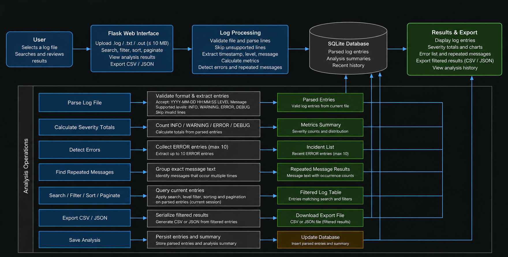
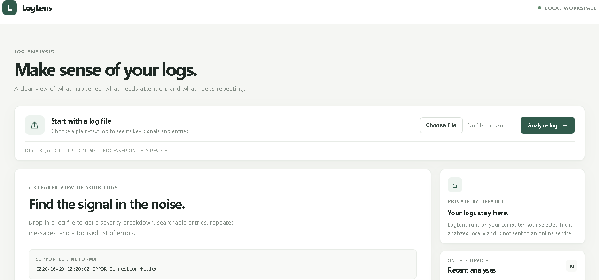
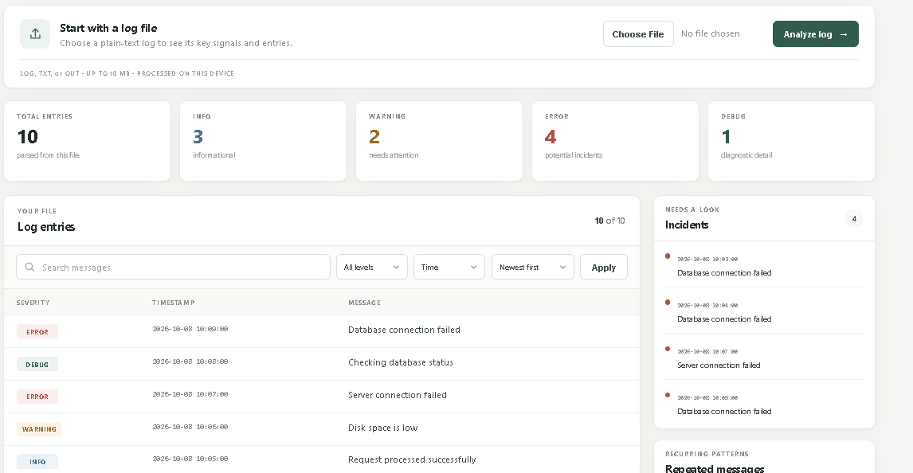
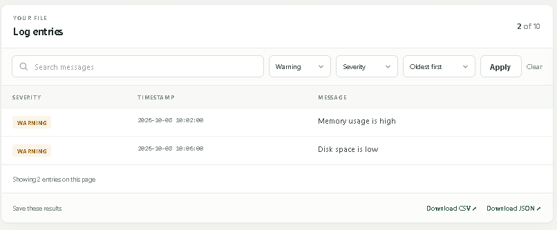

# LogLens

LogLens is a local log-inspection workspace built with Python and Flask. It helps developers analyze log files, review severity totals, search and sort entries, identify errors and repeated messages, and export results for further investigation.

All log files are analyzed locally on your computer. Parsed entries and recent analysis summaries are stored in a local SQLite database, keeping the application simple and self-contained.

## Features

- **Local log analysis:** Analyze log files directly on your computer.
- **Multiple file formats:** Upload `.log`, `.txt`, and `.out` files.
- **Severity statistics:** View counts for INFO, WARNING, ERROR, and DEBUG entries.
- **Log search:** Search entries by message text.
- **Filtering and sorting:** Filter entries by severity and sort results.
- **Error inspection:** Review detected error entries.
- **Repeated message detection:** Identify messages that occur multiple times.
- **Data export:** Export filtered log entries to CSV or JSON.
- **Analysis history:** Review recent analysis summaries stored in SQLite.
- **Pagination:** Navigate through parsed log entries.
- **Automated tests:** Run the test suite using Python's built-in `unittest` framework.

## Workflow Architecture

The diagram below illustrates the LogLens workflow, from log file upload and processing to database storage, analysis, filtering, and CSV/JSON export.



## Screenshots

### 1. Dashboard

The main interface for accessing LogLens and working with log files.



### 2. Log Analysis

Review parsed log entries and analyze severity counts, errors, and repeated messages.



### 3. Search and Filtering

Search log messages and narrow down entries to investigate specific events.



## Tech Stack

- **Language:** Python 3.10+
- **Web Framework:** Flask
- **Database:** SQLite
- **Frontend:** HTML and CSS
- **Testing:** Python `unittest`

## Requirements

- Python 3.10 or later
- Windows PowerShell or another terminal
- A modern web browser

## Run Locally

### 1. Clone or download the repository

Open a terminal in the project directory.

### 2. Create a virtual environment

```powershell
python -m venv venv
```

### 3. Activate the virtual environment

```powershell
.\venv\Scripts\Activate.ps1
```

If PowerShell blocks script execution, use Command Prompt and activate the environment with:

```bat
venv\Scripts\activate.bat
```

### 4. Install dependencies

```powershell
python -m pip install -r requirements.txt
```

### 5. Start the application

```powershell
python app.py
```

### 6. Open LogLens

Navigate to:

http://127.0.0.1:5000

The local SQLite database is created automatically when the application first runs.

## How to Use

1. Start LogLens and open the dashboard.
2. Upload a `.log`, `.txt`, or `.out` file.
3. Review the parsed entries and severity statistics.
4. Search messages, filter by severity, and sort the results.
5. Inspect error entries and repeated messages.
6. Export the filtered results to CSV or JSON.
7. Review recent analysis summaries when needed.

## Supported Log Format

LogLens recognizes entries in the following format:

```text
YYYY-MM-DD HH:MM:SS LEVEL Message text
```

Example:

```text
2026-10-20 09:15:12 INFO Application started
2026-10-20 09:15:18 DEBUG Loading configuration
2026-10-20 09:15:25 WARNING Connection retry initiated
2026-10-20 09:15:31 ERROR Database connection failed
2026-10-20 09:15:45 ERROR Database connection failed
```

### Supported Severity Levels

| Level | Description |
|---|---|
| `INFO` | General application events |
| `WARNING` | Potential issues requiring attention |
| `ERROR` | Errors that may require investigation |
| `DEBUG` | Diagnostic information |

## Log Processing Behavior

- Only lines matching the supported log format are parsed.
- Lines that do not match the expected format are skipped.
- Uploaded files are limited to 10 MB.
- The incident list displays up to 10 `ERROR` entries.
- Repeated messages are identified by comparing their exact message text.
- Search, filtering, sorting, and pagination help navigate parsed entries.
- Export operations include the currently filtered results.
- Recent analysis history stores summary counts.
- The currently selected file's entries are available for the current browser session.

## Running Tests

LogLens includes automated tests using Python's built-in `unittest` framework.

Run the test suite from the project root:

```powershell
python -m unittest discover -s tests -v
```

The tests use a temporary database, so they do not modify your local analysis history.

## Local Data and Privacy

LogLens is designed to analyze files locally.

- The SQLite database is named `loglens.db`.
- It is stored alongside `app.py`.
- The database contains recent analysis summaries and parsed log entries.
- Uploaded files are not saved as separate files.
- The database is excluded from Git.

To clear local analysis history and stored entries, stop the application and delete `loglens.db`. The application will create a new database the next time it runs.

**Important:** Deleting `loglens.db` permanently removes the analysis history and parsed entries stored in that database.

## Project Structure

```text
LogLens/
├── app.py
├── config.py
├── database.py
├── detector.py
├── log_parser.py
├── metrics.py
├── requirements.txt
├── README.md
├── .gitignore
├── templates/
│   └── index.html
├── static/
│   └── styles.css
├── screenshots/
│   ├── dashboard.png
│   ├── analysis.png
│   └── search-and-filtering.png
└── tests/
```

### Core Modules

| File | Responsibility |
|---|---|
| `app.py` | Flask routes and dashboard |
| `config.py` | Local runtime settings |
| `database.py` | SQLite persistence and database operations |
| `detector.py` | Error and incident detection |
| `log_parser.py` | Log parsing, search, grouping, and sorting |
| `metrics.py` | Severity counts and log statistics |
| `templates/index.html` | Dashboard HTML template |
| `static/styles.css` | Dashboard styling |
| `tests/` | Automated test suite |

## Design Goals

- Keep log analysis local and straightforward.
- Provide a clear interface for investigating application logs.
- Make errors and repeated messages easier to identify.
- Support practical filtering and exporting workflows.
- Keep persistence lightweight with SQLite.
- Maintain a testable, modular Python codebase.
---